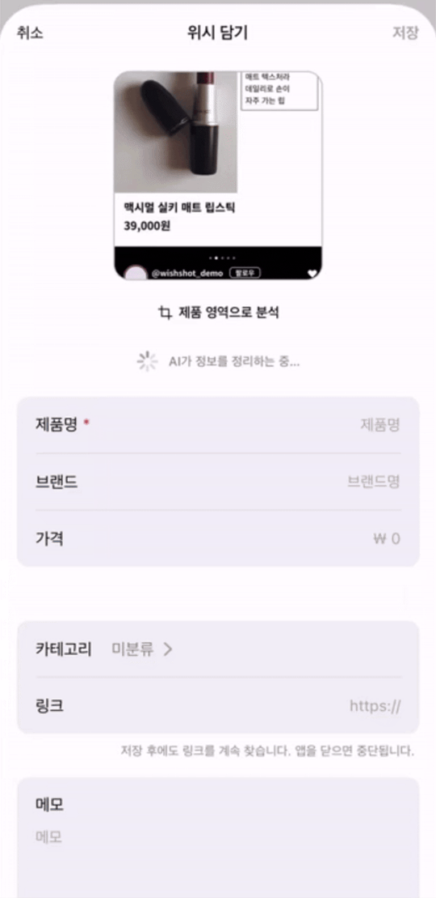
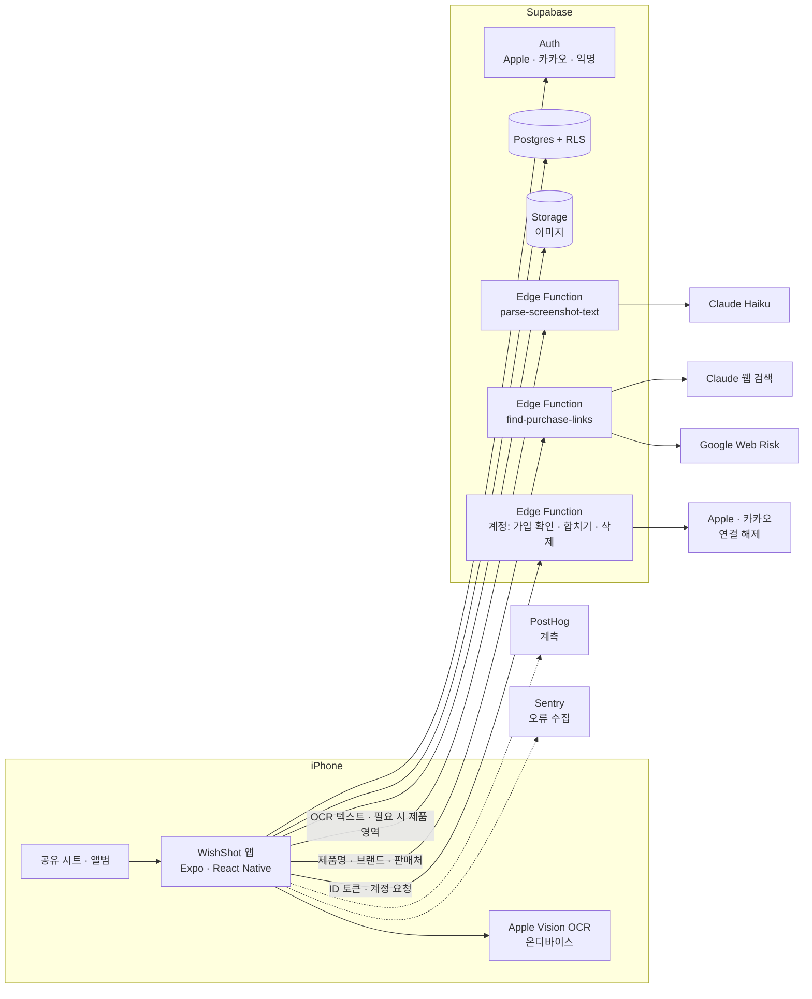
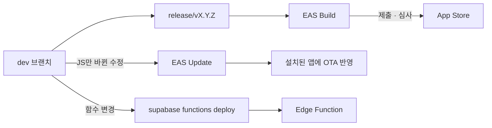

  

# 위시샷 - 스크린샷으로 시작되는 개인 위시리스트

### 캡처만 해두고 잊어버린 그 물건, 위시샷에 담아보세요!

*ZARA 26SS 추천, 다이소 자취생 필수템* 등 추천 콘텐츠가 쏟아지는 요즘, 마음에 드는 제품을 캡처해 놓지만, 정작 필요할 때 다시 찾기 어려운 경험에서 시작되었습니다.

**WishShot**은 스크린샷으로 저장한 관심 아이템을 개인 위시리스트로 정리하고 관리할 수 있는 서비스입니다. 추억은 앨범에 그대로 두고, 구매를 고민하던 기록만 따로 모아 언제든 다시 확인할 수 있도록 돕습니다.

흩어진 캡처를 단순한 사진이 아닌 내 취향과 관심사 리스트로 바꿔보면 어떨까요?

👉 [App Store에서 다운로드](https://apps.apple.com/app/apple-store/id6812149556?pt=129399010&ct=github_readme_about&mt=8)

## 서비스 소개

### 스크린샷을 등록하면 정보가 알아서 채워져요 🔗

  

***캡처하고, 공유하면 끝!***

사진 속 글자를 읽어 제품명·가격·브랜드를 채우고, 어울리는 카테고리도 골라요.

SNS에서 찍은 스크린샷을 공유 시트로 바로 보내면 더 간편하게 저장할 수 있어요.

***사고 싶을 때 바로 이동!***

제품을 파는 곳을 찾아 링크를 넣고, 안전이 확인된 링크만 넣어요.

저장한 뒤에 링크를 찾으면 앱 안 알림 탭에서 알려 드려요.

## 기술 스택

### 모바일

  
  
  
  
  

### 백엔드

  
  
  
  

### 인프라

  

### 모니터링

  
  

## 프로젝트 구조

| 폴더 | 내용 |
| :--- | :--- |
| [src](src/) | Expo Router 화면, 컴포넌트, 훅, 데이터 레이어 |
| [modules/expo-vision-ocr](modules/expo-vision-ocr/) | Apple Vision으로 글자를 읽는 로컬 네이티브 모듈 |
| [supabase](supabase/) | DB 마이그레이션, Edge Function, 정책 검증 SQL |
| [docs](docs/) | 개발 가이드, 작업 기록, 디자인 명세, 개인정보처리방침 |
| [assets](assets/) | 앱 아이콘과 스플래시 이미지 |
| [.github](.github/) | PR·이슈 템플릿 |

## 개발 문서

로컬 실행 방법과 배포·운영 절차 등 자세한 개발 정보는 아래 문서를 참고해 주세요.

| 주제 | 문서 |
| :--- | :--- |
| 읽는 순서, 작업 기록 목록, 용어 | [문서 안내](docs/README.md) |
| 로컬 실행, 빌드·출시, DB, Edge Function 배포·운영 | [개발 가이드](docs/development.md) |
| 단계별 작업 지시와 결과 | [작업 기록](docs/phases/) |
| 디자인 명세 | [비주얼 스펙](docs/design/phase-5-visual-spec.md) |
| 계측 이벤트 정의 | [트래킹 플랜](docs/testing/tracking-plan.md) |
| 저장소 작업 규칙 | [CLAUDE.md](CLAUDE.md) |

## 프로젝트 아키텍처

별도 서버 없이 앱이 Supabase를 직접 호출하고, API 키가 필요한 작업만 Edge Function에서 처리합니다.

### 빌드·배포

## 만든 사람

<table>
  <tr>
    <td align="left"></td>
  </tr>
  <tr>
    <td align="left"><a href="https://github.com/k0nghaa">경하</a></td>
  </tr>
</table>
